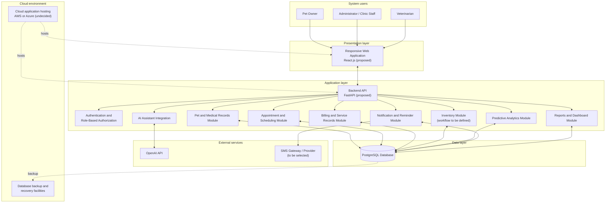
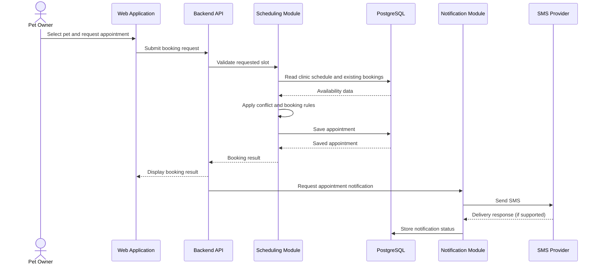
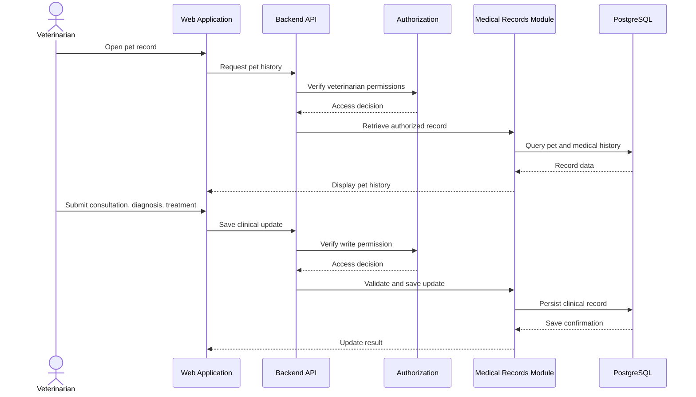
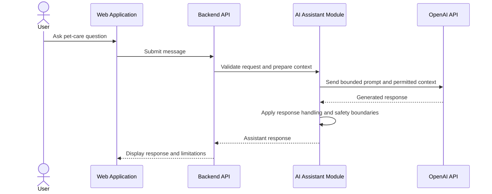
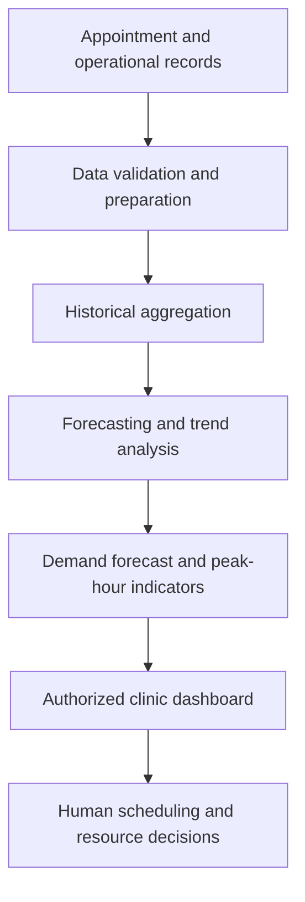
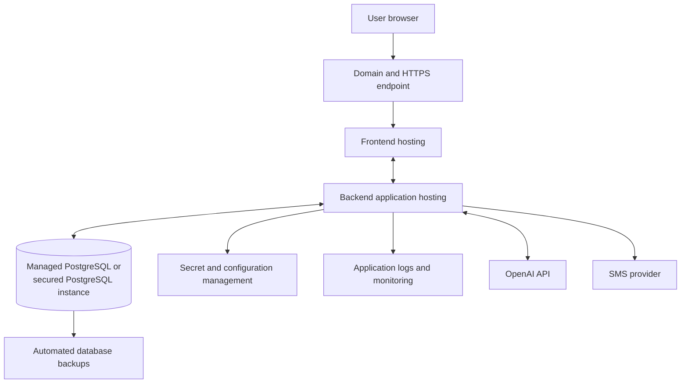

# IntelliVet — System Architecture

**Project:** IntelliVet: An Intelligent Centralized Veterinary System for AI-Assisted Operations  
**Architecture type:** Logical system architecture and proposed deployment view  
**Scope:** Single-clinic, cloud-hosted web application  
**Status:** Proposed architecture based on the submitted concept paper

---

## 1. Architecture overview

IntelliVet is designed as a centralized web application that connects pet owners, clinic staff, and veterinarians to shared veterinary and operational data. Users access the system through a browser. The frontend communicates with a backend API, which applies business rules, enforces authorization, coordinates database operations, and connects to external services.

The PostgreSQL database is the central source of structured application data. AI-assisted functions use an external AI API, identified in the concept paper as the OpenAI API. SMS notifications are delivered through an SMS provider that still needs to be selected. Predictive analytics uses historical appointment and operational data to produce forecasts and trends for clinic planning.

The concept paper specifies a frontend, backend, database, AI integration, and cloud deployment, but it does not prescribe a detailed deployment topology. This document therefore presents a practical logical architecture. The recommendation is to begin with a modular backend application rather than introducing distributed microservices for a single-clinic deployment.

## 2. Architecture goals

- Centralize pet, owner, appointment, clinical, billing, and relevant operational information.
- Keep the web interface separate from backend business logic and data persistence.
- Enforce role-based access for administrators/clinic staff, veterinarians, and pet owners.
- Keep AI and predictive features as supporting capabilities, not authorities for clinical decisions.
- Support automated SMS communication.
- Make the application deployable on a cloud platform such as AWS or Azure.
- Keep the initial architecture understandable and maintainable for a single-clinic project.
- Allow components such as notification delivery and analytics processing to be separated later if actual workload requires it.

## 3. High-level logical architecture



**Diagram interpretation:** Users interact with one web application. The backend exposes application capabilities through a controlled API. Application modules share a centralized PostgreSQL data store. The assistant and SMS delivery depend on external services. Cloud hosting and backup are deployment concerns rather than user-facing modules.

## 4. Architecture layers

### 4.1 Presentation layer

The presentation layer is the web interface used by all three user groups.

**Responsibilities**
- Display role-appropriate dashboards and navigation.
- Provide forms and views for pet profiles, appointments, medical records, billing, and reports.
- Allow pet owners to book appointments and view permitted pet information.
- Present AI assistant conversations and care reminders.
- Display analytics summaries to authorized clinic users.
- Validate basic input before submitting requests to the backend.

**Proposed technology:** React.js. The concept paper also lists Vue.js as an alternative. The final frontend framework is not confirmed by the source document.

The interface should be responsive so that pet owners and clinic personnel can access the system from supported desktop and mobile browsers.

### 4.2 Application layer

The application layer contains the business rules and workflows. A modular backend keeps related capabilities organized while allowing them to run as one deployable application in the initial release.

#### Authentication and authorization

- Authenticate users before access to protected functions.
- Identify the user's role.
- Check whether the user is allowed to perform the requested action.
- Restrict pet owners to their associated pet records.
- Separate clinical permissions from administrative permissions.

The concept paper requires secure, controlled access. The exact permission matrix should be confirmed with the clinic.

#### Pet and medical records module

- Create and maintain pet profiles.
- Associate pets with their owners.
- Store consultation history, diagnoses, treatments, and vaccination details.
- Retrieve a pet's centralized history for authorized veterinarians.
- Expose only permitted information to pet owners.

#### Appointment and scheduling module

- Accept appointment requests from pet owners.
- Retrieve clinic availability and configured scheduling constraints.
- Prevent conflicting bookings.
- Support intelligent or AI-assisted slot recommendations.
- Store appointment status and history.
- Trigger notification events when applicable.

The concept paper does not define the scheduling algorithm or detailed calendar rules. A deterministic availability and conflict-checking layer should remain authoritative even if an AI or optimization component suggests slots.

#### Billing and service records module

- Record services rendered.
- Calculate or compile charges using configured service amounts.
- Produce billing summaries.
- Keep billing records linked to the relevant pet and visit.
- Avoid online payment processing.

Physical payment remains outside the system's payment-processing scope.

#### Inventory module

Inventory management appears in the specific objectives and in the rationale for integrated operations. However, the concept paper does not detail the inventory workflow. It should be treated as a module boundary whose data model and operations require clinic validation before implementation.

#### AI assistant module

- Receive a user question from the web application.
- Prepare only the context needed for the request.
- Send the request to the configured AI API.
- Return the response to the user.
- Apply system-level safety instructions and clearly communicate that the assistant cannot diagnose or prescribe.
- Support appointment-booking assistance without bypassing the scheduling module's rules.

The AI service must not write a diagnosis or treatment into the clinical record as if it were a veterinarian. Clinical records remain under authorized practitioner control.

#### Predictive analytics module

- Read historical appointment and relevant operational data.
- Identify appointment-volume patterns and peak clinic hours.
- Produce demand forecasts.
- Present insights for scheduling and resource planning.
- Generate pet-care reminders from available pet data and configured reminder rules.

The concept paper does not specify a particular machine-learning algorithm. The first implementation should select a method only after examining data availability and quality. The module must communicate that predictions are estimates.

#### Notification and reminder module

- Create notification jobs from appointment and care-reminder events.
- Format SMS content.
- Submit messages to the selected SMS provider.
- Store message status and relevant timestamps.
- Expose failed or pending notifications to authorized clinic personnel where appropriate.

An SMS provider is not named in the concept paper. Provider selection, delivery callbacks, retry policy, and message-cost controls remain design decisions.

#### Reports and dashboard module

- Aggregate authorized data for staff dashboards.
- Present appointment activity and billing summaries.
- Present predictive analytics outputs.
- Provide pet owners with a personalized view of their pets' permitted records, appointment history, and reminders.

### 4.3 Data layer

PostgreSQL is the database technology identified in the concept paper.

The database acts as the centralized source of truth for structured application data. The backend should be the primary access path so that validation, authorization, and business rules are applied consistently.

**Conceptual data domains**
- Users and roles
- Pet owners
- Pets
- Medical records and consultations
- Diagnoses and treatments
- Vaccination and care schedules
- Appointments and appointment statuses
- Services and billing records
- Inventory records (subject to scope definition)
- Notifications and delivery statuses
- Analytics results or forecast metadata

These domains are logical groupings, not a finalized entity-relationship diagram. The final schema must be designed after clinic workflows and required fields are confirmed.

## 5. Key data flows

### 5.1 Appointment booking



The scheduling module must validate availability before saving. An AI-assisted recommendation may help choose a slot, but the authoritative availability check must use current clinic scheduling data.

### 5.2 Consultation and medical record update



### 5.3 AI assistant request



The assistant's response is informational. It does not replace an examination, diagnosis, or prescription by a licensed veterinarian.

### 5.4 Analytics flow



Analytics can only produce useful forecasts when sufficient, relevant, and reasonably consistent historical data exists.

## 6. Deployment architecture

The concept paper proposes cloud deployment using AWS or Azure but does not choose a provider or name individual cloud services. The following is a provider-neutral deployment model.



**Deployment responsibilities**
- **Frontend hosting:** serves the built web application over HTTPS.
- **Backend hosting:** runs the API and application modules.
- **Database hosting:** runs PostgreSQL with restricted network access and backup procedures.
- **Secrets/configuration:** stores API credentials and environment-specific settings outside source code.
- **Logging/monitoring:** captures application errors and operational events without unnecessarily exposing sensitive clinical information.
- **Backups:** supports database recovery.
- **External services:** OpenAI and the selected SMS provider are reached through controlled backend integrations.

The actual AWS/Azure service mapping, network layout, environment count, and cost plan are implementation decisions.

## 7. Security and privacy architecture

The concept paper identifies the Philippine Data Privacy Act of 2012 (RA 10173) and controlled access to user and clinical data. The following are recommended technical controls to support those requirements; they are not a claim of legal certification.

1. **Authentication:** require sign-in for protected functions.
2. **Role-based authorization:** enforce permissions in the backend, not only by hiding frontend controls.
3. **Ownership checks:** verify that a pet owner is associated with the requested pet before returning its records.
4. **Transport protection:** use HTTPS for browser-to-backend and backend-to-provider communication where supported.
5. **Secret handling:** keep database credentials and external API keys out of source control and client-side code.
6. **Input validation:** validate and constrain user-supplied data before persistence or external API use.
7. **Data minimization:** send only the context required for AI requests and notifications.
8. **Auditability:** consider recording important changes to clinical and administrative records, with access to audit information restricted appropriately.
9. **Backup protection:** protect backup access and define restoration procedures.
10. **Error handling:** avoid exposing database details, credentials, or sensitive record contents in user-facing errors.
11. **Retention and consent:** define data retention, privacy notices, consent, and AI-data handling with the clinic before production use.

## 8. Reliability, performance, and operational considerations

- The application depends on internet connectivity for real-time scheduling, analytics, and external AI/SMS calls.
- External provider failures should not corrupt core records. For example, a failed SMS delivery should be recorded separately from the appointment itself.
- Notification delivery should be designed so that temporary provider errors can be identified and handled. Exact retry behavior is still to be defined.
- Database backups and restoration should be tested, not merely configured.
- Predictive analytics should degrade gracefully when data is insufficient: the interface should show that a forecast is unavailable or low-confidence rather than inventing a result.
- The system should be tested with realistic clinic workflows and representative data volumes.
- The single-clinic scope does not require a distributed microservice architecture at the outset.

## 9. Recommended application organization

A possible backend code organization is:

```text
intellivet/
├── frontend/
│   ├── src/
│   │   ├── components/
│   │   ├── pages/
│   │   ├── features/
│   │   │   ├── authentication/
│   │   │   ├── pets/
│   │   │   ├── appointments/
│   │   │   ├── medical-records/
│   │   │   ├── billing/
│   │   │   ├── inventory/
│   │   │   ├── assistant/
│   │   │   └── analytics/
│   │   └── services/
│   └── ...
├── backend/
│   ├── app/
│   │   ├── api/
│   │   ├── core/
│   │   ├── auth/
│   │   ├── users/
│   │   ├── pets/
│   │   ├── medical_records/
│   │   ├── appointments/
│   │   ├── billing/
│   │   ├── inventory/
│   │   ├── notifications/
│   │   ├── assistant/
│   │   ├── analytics/
│   │   └── reports/
│   └── tests/
├── docs/
│   ├── PRD.md
│   ├── SYSTEM_ARCHITECTURE.md
│   └── TECH_STACK.md
└── README.md
```

This is an illustrative organization, not a required repository structure. It assumes the proposed React and FastAPI baseline.

## 10. Architecture decisions and unresolved choices

| Topic | Current position | Decision still needed |
|---|---|---|
| Application style | Centralized web application; modular backend recommended | Confirm whether the team will use a modular monolith |
| Frontend | React.js or Vue.js in source; React selected here as a proposal | Final framework and UI library |
| Backend | FastAPI or Django in source; FastAPI selected here as a proposal | Final framework and API conventions |
| Database | PostgreSQL | Hosting model, schema, backup plan |
| AI | OpenAI API named in source | Model, API usage policy, privacy controls, cost limits |
| SMS | SMS notifications required | Provider, pricing, delivery callbacks |
| Cloud | AWS or Azure | Provider, region, service mapping, budget |
| Analytics | Predictive analytics required | Model, data sufficiency criteria, forecast horizon, metrics |
| Inventory | Included in an objective | Detailed workflows and release priority |
| Scheduling optimization | Intelligent booking optimization required | Rules, constraints, and optimization method |

## 11. Source alignment note

This architecture translates the concept paper's stated web frontend, Python backend, PostgreSQL database, OpenAI integration, cloud deployment, user roles, core modules, and limitations into a coherent logical design. Specific choices such as React, FastAPI, a modular monolith, backend module boundaries, and the deployment diagram are proposed implementation details, not finalized choices in the concept paper.
