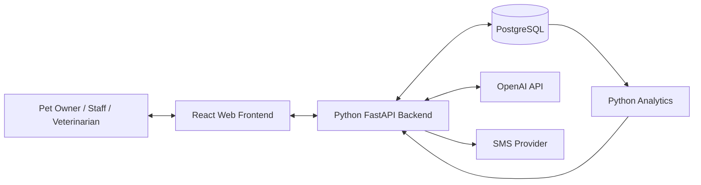

# IntelliVet — Technology Stack

**Project:** IntelliVet: An Intelligent Centralized Veterinary System for AI-Assisted Operations  
**Purpose:** Explain the technologies proposed for implementation and how they work together  
**Status:** Recommended baseline based on the submitted concept paper

---

## 1. Stack overview

IntelliVet is planned as a cloud-hosted web application with a browser-based frontend, a Python backend, a PostgreSQL database, AI integration, and an SMS notification service.

The concept paper lists alternatives for some technologies:

- Frontend: React.js or Vue.js
- Backend: Python using FastAPI or Django
- Database: PostgreSQL
- AI integration: OpenAI API
- Cloud deployment: AWS or Azure

To make the architecture easier to implement and discuss, this document proposes one consistent baseline: **React.js + Python FastAPI + PostgreSQL**, with the **OpenAI API** for the assistant and a yet-to-be-selected SMS provider. AWS and Azure remain deployment alternatives until the project team chooses one.

The selected baseline is a recommendation for planning. It should not be described as an already-approved or implemented stack unless the project team confirms it.

## 2. Proposed stack at a glance

| Layer | Proposed technology | Role in IntelliVet |
|---|---|---|
| Frontend | React.js | Builds the browser-based user interface |
| Frontend language | JavaScript or TypeScript | Implements interface behavior and application logic |
| Styling | CSS or a selected component/styling solution | Controls layout, responsiveness, and visual presentation |
| Backend | Python + FastAPI | Provides API endpoints and runs business rules |
| API format | REST-style HTTP API (proposed) | Connects the frontend to backend capabilities |
| Database | PostgreSQL | Stores centralized structured clinic data |
| Data access | Python database driver / ORM (to be selected) | Maps backend operations to database queries |
| AI integration | OpenAI API | Powers conversational pet-care assistance and booking support |
| SMS integration | SMS gateway/provider (TBD) | Sends appointment notifications and reminders |
| Analytics | Python data-processing and forecasting libraries (TBD) | Analyzes historical appointments and produces operational insights |
| Hosting | AWS or Azure (undecided) | Hosts the frontend, backend, and database infrastructure |
| Version control | Git and a Git hosting platform (recommended) | Tracks source code and supports team collaboration |
| Testing | Python and frontend test tools (to be selected) | Validates modules, API behavior, and user workflows |

The concept paper does not name a frontend styling framework, ORM, SMS vendor, analytics library, testing framework, or version-control platform. Those are intentionally left as implementation choices.

## 3. Frontend

### React.js

**Purpose:** React.js is the proposed framework for building IntelliVet's interactive web interface.

The frontend is the part of the system users see and interact with. It presents different screens and actions depending on whether the signed-in user is an administrator/clinic staff member, veterinarian, or pet owner.

**How it is used**
- Render role-specific dashboards.
- Display pet profiles and permitted medical information.
- Provide appointment search, booking, and management screens.
- Present consultation and treatment forms to authorized veterinarians.
- Provide service and billing-summary screens for clinic staff.
- Display the AI assistant interface.
- Show care reminders, appointment history, and analytics visualizations.
- Communicate with the backend API to load and save data.

**Why it is a suitable proposal**
- Component-based development allows repeated interface elements to be reused.
- It supports interactive dashboards and form-driven workflows.
- It can build responsive web experiences for desktop and mobile browsers.
- It has a broad ecosystem of supporting libraries.

**Alternative in the concept paper:** Vue.js. The team should select one framework rather than mixing React and Vue in the same frontend.

### JavaScript or TypeScript

The concept paper names React.js or Vue.js but does not specify the frontend language. Both can be used with JavaScript or TypeScript.

TypeScript is a reasonable project recommendation because it adds static type checking to application code. This can help the team manage structured data such as pet profiles, appointment objects, billing records, and API responses. JavaScript remains a valid option if the team prefers a simpler setup or has already established a JavaScript codebase.

### Styling and responsive layout

The concept paper requires a user-friendly web application but does not select a styling library. The project can use standard CSS or choose a consistent styling solution after the interface design is established.

The interface should adapt to common desktop and mobile browser sizes. It should prioritize clear forms, readable medical information, and straightforward workflows for users with different levels of technical experience.

## 4. Backend

### Python

Python is the proposed backend programming language. It will run server-side logic, process requests, apply business rules, communicate with the database, and integrate external services.

Python is also suitable for the planned analytics work because it has a mature ecosystem for data processing and forecasting.

### FastAPI

**Purpose:** FastAPI is the recommended Python web framework for building IntelliVet's backend API.

The concept paper lists FastAPI or Django. FastAPI is selected here as a proposed baseline, not as a confirmed project decision.

**How it is used**
- Expose endpoints for authentication and user operations.
- Create, retrieve, update, and manage pet profiles.
- Serve medical-record and consultation workflows.
- Validate appointment requests and enforce scheduling rules.
- Calculate billing summaries from recorded services.
- Coordinate notification and reminder requests.
- Call the OpenAI API for assistant responses.
- Run or invoke analytics processing.
- Return structured responses to the React frontend.

**Why it is a suitable proposal**
- It is designed for API development.
- It supports request and response validation.
- It provides automatic API documentation capabilities.
- It works with Python libraries for database access, data processing, and AI integration.

### API design

A REST-style HTTP API is proposed as the communication contract between the frontend and backend. For example, the application may expose logical resources for users, pets, appointments, medical records, billing, reminders, and analytics.

The exact endpoint names, versioning rules, authentication method, and response format must be defined during implementation. The frontend should not connect directly to the PostgreSQL database.

## 5. Database

### PostgreSQL

**Purpose:** PostgreSQL is the central relational database for IntelliVet.

The system handles related information: a pet belongs to an owner, a pet may have many appointments, a pet may have many medical records, and a visit may have associated services and billing records. A relational database is appropriate for maintaining these relationships and supporting structured queries.

**Expected data**
- User accounts and roles
- Pet owner profiles
- Pet profiles
- Consultation and medical records
- Diagnoses and treatments
- Vaccination and care information
- Appointment records and statuses
- Service records and billing summaries
- Inventory data, if the clinic-approved inventory scope is implemented
- Notification and reminder records
- Analytics outputs or metadata

**Why PostgreSQL**
- It supports relational tables and foreign-key relationships.
- It provides transactions to help preserve data consistency.
- It supports indexes for frequently queried information.
- It is suitable for structured operational records.
- It can support reporting queries over appointment and billing data.

### Data modeling considerations

The team should design the database around confirmed clinic workflows. For example:

- A pet should be linked to its owner.
- An appointment should be linked to the relevant pet and, where applicable, assigned clinic personnel.
- A medical record should be linked to the pet and the responsible veterinarian or authorized practitioner.
- Billing entries should be traceable to the relevant visit or service record.
- Notification records should be linked to the event or recipient they concern.

These are conceptual relationships. The final ERD, field definitions, constraints, and deletion/retention policies still need to be designed.

## 6. AI integration

### OpenAI API

**Purpose:** The concept paper identifies the OpenAI API for the AI-powered pet assistant.

The assistant is intended to help users with common pet-care questions, provide basic guidance, and assist with appointment booking. It is not intended to replace a veterinarian.

**Request flow**
1. A user submits a message through the web interface.
2. The frontend sends the message to the IntelliVet backend.
3. The backend checks the request and prepares the context needed for the response.
4. The backend sends the request to the OpenAI API.
5. The AI service returns generated text.
6. The backend applies the application's response-handling rules and returns the result to the frontend.

**Important implementation boundaries**
- Keep the API key on the backend. Never expose it in browser code.
- Send only the information required for the request.
- Do not treat AI output as a diagnosis, prescription, or confirmed clinical instruction.
- Make it clear that clinical decisions belong to licensed veterinarians.
- Define how conversations are stored, retained, and protected before production use.
- Set usage limits and monitor API costs.

The exact OpenAI model, prompt design, safety implementation, and data-retention policy are not specified in the concept paper.

## 7. SMS notification integration

The concept paper requires automated SMS notifications for appointments and identifies SMS as a relevant local communication channel. It does not name a provider.

**Purpose**
- Notify pet owners about appointment events.
- Send appointment reminders.
- Potentially deliver pet-care reminders, depending on the clinic's confirmed notification policy.

**How it fits into the system**
1. An appointment or reminder event is created in IntelliVet.
2. The backend creates a notification request.
3. The notification component formats the message.
4. The component sends the request to the SMS provider.
5. The system stores the provider response or delivery status when available.

**Provider selection criteria**
- Availability and coverage in the Philippines.
- Local SMS pricing and billing model.
- API documentation and integration support.
- Delivery-status callbacks or reporting.
- Sender ID rules and regulatory requirements.
- Rate limits, reliability, and support.

The SMS provider should be chosen after checking the clinic's expected message volume and budget.

## 8. Predictive analytics

Predictive analytics is a stated IntelliVet capability. The concept paper identifies the intended outputs but does not name a particular algorithm or library.

**Required outputs**
- Forecast future appointment demand using historical data.
- Identify peak clinic hours and appointment trends.
- Support future schedule optimization and resource allocation.
- Generate vaccination, grooming, and routine-care reminders from pet data.

**Proposed implementation approach**
- Use Python for data preparation and analysis.
- Begin with descriptive summaries and trend analysis to understand the available data.
- Evaluate whether historical data is sufficient for forecasting.
- Select a forecasting method based on the dataset, forecast horizon, and evaluation results.
- Present predictions as estimates and expose limitations when data is sparse or incomplete.

A particular machine-learning library or model should not be selected solely because it is popular. The team should first determine what historical records exist, how complete they are, and what the clinic needs to predict.

## 9. Cloud deployment

The concept paper proposes cloud deployment using AWS or Azure. It does not identify specific services or select a provider.

A cloud environment is intended to make IntelliVet accessible to authorized users over the internet and to support centralized hosting.

**Logical hosting needs**
- Frontend hosting for the built web application.
- Backend application hosting for the Python API.
- PostgreSQL database hosting.
- Secure configuration and secret storage.
- Application logs and monitoring.
- Database backups and a tested recovery process.
- Secure outbound connectivity to the OpenAI API and SMS provider.

**AWS or Azure selection criteria**
- Total hosting and database cost.
- Availability of managed PostgreSQL options.
- Ease of deploying the selected frontend and backend.
- Backup and monitoring capabilities.
- Region availability and data-governance requirements.
- Team familiarity and operational complexity.

The project should select one cloud provider for the initial deployment instead of attempting to operate on both.

## 10. Development tools and engineering practices

These are recommended project practices, not technologies explicitly mandated by the concept paper.

### Git and repository hosting

Use Git for source-code version control. A shared Git repository supports collaboration, code review, issue tracking, and release history.

### Environment configuration

Maintain separate configuration for local development and production. Database credentials, AI API keys, and SMS credentials should be supplied through environment configuration or a secret-management service, not committed to the repository.

### Testing

The concept paper explicitly identifies:
- Unit testing
- Integration testing
- User Acceptance Testing (UAT)

Recommended coverage:
- Unit tests for scheduling rules, billing calculations, validation, and permission checks.
- Integration tests for API/database interactions and external-service adapters.
- UAT sessions with veterinary practitioners and clinic staff to assess actual workflows.

### Documentation

Maintain:
- Setup instructions
- Environment variable documentation without exposing secret values
- API documentation
- Database/ERD documentation
- Deployment and backup procedures
- User guides for clinic staff, veterinarians, and pet owners

## 11. How the technologies work together

1. Users interact with the React web application.
2. React sends requests to the FastAPI backend.
3. FastAPI authenticates the user, checks permissions, applies business rules, and reads or writes PostgreSQL data.
4. When a user asks the pet assistant a question, the backend communicates with the OpenAI API and returns the response.
5. When an appointment or reminder requires a text message, the backend communicates with the configured SMS provider.
6. The analytics component reads historical data and returns operational insights for authorized dashboards.

This separation keeps the browser focused on presentation, the backend responsible for application rules, and PostgreSQL responsible for persistent structured data.

## 12. Proposed environment separation

| Environment | Purpose | Data guidance |
|---|---|---|
| Local development | Individual developer work and initial testing | Use synthetic or appropriately de-identified sample data |
| Testing / staging | Integration testing and clinic workflow validation | Use test accounts and controlled test data |
| Production | Actual clinic operation | Use authorized real data with production security, backup, and access controls |

The number and configuration of environments should be balanced against the project's hosting budget and operational capacity.

## 13. Stack decisions still required

| Decision | Current recommendation | Confirmation needed |
|---|---|---|
| Frontend framework | React.js | Confirm React versus Vue |
| Frontend language | TypeScript preferred; JavaScript acceptable | Team preference and experience |
| Styling solution | Not selected | Choose after UI design |
| Backend framework | FastAPI | Confirm FastAPI versus Django |
| Database | PostgreSQL | Select hosting and backup configuration |
| ORM/database access | Not selected | Choose based on schema and team familiarity |
| AI model | OpenAI API | Select model, budget, and data policy |
| SMS provider | Not selected | Compare Philippine delivery coverage and cost |
| Analytics library/model | Not selected | Inspect available data and define evaluation |
| Cloud provider | AWS or Azure | Choose one based on budget and operational needs |
| Testing libraries | Not selected | Define with implementation framework |

## 14. Final recommendation

For a manageable first implementation, use a single web frontend, one modular Python backend, and one PostgreSQL database. Integrate the OpenAI API and SMS provider through backend modules. Keep analytics within the Python application initially unless measured workload or development needs justify separating it.

This approach fits the concept paper's single-clinic scope and avoids adding unnecessary infrastructure before the clinic's workflows and data volume are known. The team should finalize the unresolved provider and framework decisions before implementation begins.

---

## Source alignment note

The source concept paper explicitly proposes React.js or Vue.js, Python FastAPI or Django, PostgreSQL, the OpenAI API, and AWS or Azure. This document recommends React.js and FastAPI as a consistent baseline for planning, while preserving the alternatives and identifying all additional tooling and providers as decisions still to be made.
